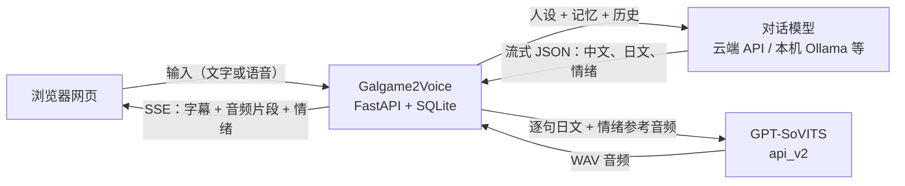

<div align="center">

# Galgame2Voice

**用中文聊天，听 Galgame 角色用日语原声回答。**

[](https://github.com/LevenST24/galgame2voice/actions/workflows/ci.yml)


[](LICENSE)

</div>

Galgame2Voice 是一个运行在你自己电脑上的角色对话程序。对话由你配置的大模型生成，每条回复同时包含**中文字幕**和**日语台词**：中文立即显示，日语逐句交给你自己的 [GPT-SoVITS](https://github.com/RVC-Boss/GPT-SoVITS) 引擎合成，边生成边播放；角色的情绪决定用哪段参考音频说话，也决定立绘换成什么表情。

程序本身**不附带任何游戏角色、模型权重或 API Key**，你需要准备：

- **对话模型**：云端 API（DeepSeek、Gemini、OpenAI 等），或本机运行的 Ollama / LM Studio；
- **角色语音（可选）**：GPT-SoVITS 引擎，以及你有权使用的角色模型（GPT `.ckpt`、SoVITS `.pth`）和参考音频。

没有 GPT-SoVITS 也能使用，只是只有文字、没有语音。

## 目录

- [功能](#功能)
- [工作原理](#工作原理)
- [快速开始](#快速开始)
- [第一次使用](#第一次使用)
- [ADV 界面与手机使用](#adv-界面与手机使用)
- [角色包](#角色包)
- [命令行与配置](#命令行与配置)
- [常见问题](#常见问题)
- [数据与隐私](#数据与隐私)
- [开发](#开发)
- [许可证](#许可证)

## ADV 界面与手机使用

应用以 ADV 舞台作为唯一界面，回复按句显示并播放语音。点击舞台、Enter 或 Space 推进（先显示完整台词，再进入下一句）；右键隐藏文本框，点击恢复；滚轮向上打开 LOG，按住 Ctrl 临时快进，Esc 关闭当前面板、恢复文本框或停止生成。输入框内保留文字编辑操作，Enter 发送，Shift+Enter 换行。快捷菜单提供 AUTO、SKIP、LOG、VOICE 重播、HIDE、CONFIG 设置和背景选择；左上角可切换会话、进入输入、切换语音及停止生成。

本地素材需自行准备：v3 分层立绘包（`layers.json` 及其引用的图片）放在 `characters/<name>/portrait/`。可在 `looks[...].faces[id]` 设置可选布尔字段 `frameOnly: true`，将该 face 限定为同一 look 的眨眼、口型或组合动画帧，无需顶层 `faces` 元数据，也不会作为表情被选择；不能用作 `defaultFace`，无人引用时仅警告。完整规则见 [v3 格式说明](docs/design/adv-ui.md#62-v3-manifest-schema-portraitlayersjson)。背景按作品分包，每个作品一个目录 `backgrounds/<work>/`，目录里的 `manifest.json` 写明作品 id（`work`，与目录名相同）、显示名、可选的默认背景 `default`，以及每个背景白天／傍晚／夜晚图片的相对路径：

```json
{"version": 1, "work": "cafe_stella", "name": "喫茶ステラ", "default": "cafe_hall",
 "backgrounds": [{"id": "cafe_hall", "name": "店内",
   "variants": {"day": "cafe_hall/day.webp", "night": "cafe_hall/night.webp"}}]}
```

角色包的 `manifest.json` 填上同一个 `work`，背景选“自动”时就显示该作品的默认背景（没写 `default` 时用第一个）；选“无（天空）”只显示渐变天空。背景面板默认只列本作品的背景，点“显示其他作品”可看到全部。这些素材仅供本地使用，**不要提交到 Git**；程序不附带游戏图片。选择背景后会预加载其时间差分，下一句已排队时也会预加载其表情图层。

舞台在各种窗口比例下保持 16:9，空余区域显示黑边。触屏可点按推进，长按舞台相当于右键隐藏；界面遵循系统的减弱动态效果设置。

## 功能

**对话**

- 多会话：每个会话单独绑定角色和采样参数（人设跟随角色），切换回来时记录原样保留。
- 内置 10 个模型服务预设：OpenAI、Anthropic Claude、Google Gemini、DeepSeek、xAI Grok、智谱 GLM、通义千问、Moonshot Kimi、SiliconFlow，以及任意 OpenAI 兼容接口（Ollama、LM Studio、vLLM、中转网关）。
- 流式输出，字幕随生成实时显示；回复失败时在消息下方说明原因，可一键重新发送或直接打开模型设置。
- 长期记忆与好感度：自动记住你的称呼等信息；好感度随对话变化，并影响立绘的脸红差分。

**语音**

- 日语台词按句合成、排队播放，第一句合成好就开口，不必等整段回复结束。
- 7 种情绪（温柔、开心、害羞、傲娇、冷静、感伤、生气）：按情绪选择角色包中的参考音频；开启「自动调节语速与语气」时，按模型给出的情绪和参数调整每句的语速与温度。
- 推理精度可选 FP16 / FP32 / CPU。自动模式下，启动器拉起引擎后先试合成一句，检测到静音会自动改用 FP32 并记住结果。
- 合成结果有内存和磁盘两级缓存，重复的台词不会重新推理。
- 内置部分 Galgame 角色名的日语读音修正，并自动去掉「（微笑）」这类括号舞台提示。
- 语音输入使用浏览器自带的语音识别（Chrome、Edge 等），同时保留录音可回放。

**角色与立绘**

- 把角色包放进 `characters/`，在会话设置里点「扫描」即可使用，无需重启。
- 没有角色包时，可直接选择引擎目录里的模型权重和参考音频新建音色。
- ADV 立绘舞台：随每句台词的情绪切换表情，支持多套服装；没有立绘素材时仍可正常对话。

**数据与部署**

- 聊天记录保存在本机 SQLite 和浏览器中，可导出完整聊天备份并导入。
- 数据库每天自动生成校验过的快照；便携版附带恢复工具 `数据恢复.bat`。
- Windows 便携版自带 Python 和 FFmpeg，解压即用；也支持源码运行和 Docker。
- 可选的 Telegram 机器人：在手机上和同一个角色聊天，并收到语音消息。

## 工作原理



模型被要求按固定的 JSON 格式回复：`chinese` 是给你看的中文，`japanese` 是用来配音的日语，`tts` 里是情绪、语速和温度。服务端边接收边解析：中文立即推送到网页，日语每凑够一句就送去合成，情绪决定参考音频和立绘表情。角色人设里没写这个格式时，程序会自动补上。

## 快速开始

### 方式一：Windows 便携版（推荐）

适合不想安装 Python 的用户。便携包文件名为 `galgame2voice-v<版本>-windows-x64.zip`，自带运行环境和 FFmpeg。

1. 右键「全部解压」到有写入权限的位置（例如「文档」）。不要放进 Program Files，也不要在压缩软件里直接运行。
2. 双击 `启动.bat`（或 `Galgame2Voice.exe`），服务就绪后浏览器会自动打开。
3. 按[第一次使用](#第一次使用)配置模型和语音。

更新、备份、数据恢复和启动故障排查见 [Windows 便携版使用说明](docs/WINDOWS_PORTABLE.md)。便携包由 Release 工作流在推送 `v*` 标签时构建，也可以[自己构建](#构建-windows-便携版)。

> 不带 `windows-x64` 的 `galgame2voice-v<版本>.zip` 是源码包，需要按方式二准备 Python 环境。

### 方式二：从源码运行

需要 Python 3.10–3.12（CI 在 3.10 和 3.12 上测试），建议在虚拟环境中安装。只有修改网页时才需要 Node.js；只有 Telegram 语音消息需要系统中有 `ffmpeg`。

```bash
git clone https://github.com/LevenST24/galgame2voice.git
cd galgame2voice
pip install -r requirements.txt
python scripts/run_server.py
```

- Windows 也可以直接双击 `启动.bat`（使用本机 Python，缺少依赖时会尝试自动安装）。
- Linux 可运行 `bash run.sh`，它会创建 `.venv`、安装依赖并启动。
- 使用 [uv](https://docs.astral.sh/uv/) 时：`uv sync --frozen`，然后 `uv run python scripts/run_server.py`。

仓库里已包含构建好的网页（`galgame2voice/static/`），克隆后无需 Node.js 即可打开界面。

### 方式三：Docker

```bash
docker compose up -d --build
```

然后打开 <http://127.0.0.1:8080>。容器默认开启访问令牌：首次启动会生成令牌并写入 `./data/.console_token`，也可以通过环境变量 `GALGAME2VOICE_CONSOLE_TOKEN` 指定。

- GPT-SoVITS 运行在宿主机时，在 `docker-compose.yml` 中取消注释 `GPT_SOVITS_BASE_URL=http://host.docker.internal:9880`。
- `docker-compose.yml` 会把当前目录下的 `data`、`audio`、`logs`、`characters` 挂载进容器，角色包直接放进宿主机的 `./characters` 即可。容器以 UID 1000 运行，宿主机用户 ID 不同时，请按 `Dockerfile` 中的说明重新构建。

## 第一次使用

打开网页后先看到标题画面：「设置」打开**全局设置**，「角色」打开**会话设置**。进入对话后，左上角「会话」抽屉的底部有「全局设置」，快捷菜单 CONFIG 面板的底部可以直接打开会话设置和「对话模型」。

1. **配置对话模型**：全局设置 →「对话模型」，选择服务，填写 API Key 和模型名称，点「测试连通性」，成功后点「保存并启用此模型」。
   - 本机或局域网模型（Ollama、LM Studio、vLLM）：选择「自定义 / 本地模型」，填写接口地址（Ollama 一般是 `http://127.0.0.1:11434/v1`，LM Studio 一般是 `http://127.0.0.1:1234/v1`），并开启「允许私网 LLM 端点」。这个开关默认关闭，只用于你信任的地址。
2. **接入 GPT-SoVITS**（需要语音时）：全局设置 →「语音服务」，点「选择文件夹」，选中包含 `api_v2.py` 的 GPT-SoVITS 目录，再点「保存目录」，然后在「运行状态」中启动引擎。如果引擎已经在别处运行，填写它的服务地址即可（默认 `http://127.0.0.1:9880`）。
   - Windows 建议使用 [GPT-SoVITS 官方整合包](https://github.com/RVC-Boss/GPT-SoVITS#windows)（自带运行环境）。本项目通过 HTTP API 对接，按 V2 Pro Plus 整合包开发；CI 不运行真实引擎，其它版本只要提供同样的 API 通常也能使用。
3. **选择角色**：会话设置 →「角色音色」，选择扫描到的角色包；或者选「＋ 新建自定义音色」，挑选 GPT 权重（`.ckpt`）、SoVITS 权重（`.pth`）和参考音频，点「创建并绑定」。最后点「保存」。
4. **开始聊天**：在标题画面点「开始」。轮到你时在文本框里输入，`Enter` 发送，`Shift + Enter` 换行，也可以点文本框里的麦克风说话。左上角的「语音开关」决定是否自动播放语音。推进、LOG、快进等操作见上文「ADV 界面与手机使用」。

### Telegram 机器人（可选）

默认关闭。在全局设置 →「Telegram」中填写 Bot Token；需要代理时一并填写代理地址（如 `http://127.0.0.1:7890` 或 `socks5://127.0.0.1:10808`），保存后立即生效，无需重启。

常用指令：`/character 名称` 切换角色，`/voice` 查看当前音色和参数，`/settings` 打开交互式设置面板，`/reset` 清空当前会话上下文（不删除长期记忆），`/help` 查看全部指令。

## 角色包

一个角色包就是 `characters/` 下的一个文件夹：

```text
characters/
└── 爱丽丝/
    ├── manifest.json        # 角色清单（必需）
    ├── system_prompt.txt    # 人设（可选；manifest 中 system_prompt 为空时读取）
    ├── gpt.ckpt             # GPT 权重
    ├── sovits.pth           # SoVITS 权重
    ├── refs/                # 各情绪的参考音频
    │   ├── gentle.ogg
    │   ├── happy.ogg
    │   └── …
    └── portrait/            # 立绘（可选）
```

`manifest.json` 示例（路径都相对于角色包目录）：

```json
{
  "id": "alice",
  "name": "爱丽丝",
  "aliases": ["Alice"],
  "system_prompt": "你是爱丽丝……（身份、性格、口吻、对玩家的称呼）",
  "gpt_weights": "gpt.ckpt",
  "sovits_weights": "sovits.pth",
  "default_emotion": "gentle",
  "default_voice_params": { "speed": 1.0, "temperature": 0.8 },
  "emotions": {
    "gentle": { "audio": "refs/gentle.ogg", "text": "参考音频里说的日语原文。", "lang": "ja" },
    "happy": { "audio": "refs/happy.ogg", "text": "……", "lang": "ja" }
  }
}
```

- 情绪名使用 `gentle`、`happy`、`shy`、`tsundere`、`cool`、`sad`、`angry`。至少需要一种，建议七种都提供。
- 每段参考音频必须是 **3–10 秒**，`text` 要与音频内容一致；不同情绪不能使用同一段音频（按内容校验）。
- 人设可以只写角色设定。是否包含中日双语 JSON 输出格式都可以，缺少时程序会自动补上。
- 放入新角色包后，在会话设置中点「扫描」即可，无需重启。不合格的包会被跳过，原因记录在日志里。
- 网页中修改的人设会写回角色包的 `manifest.json`。

**立绘**：在 `portrait/` 下为每套服装建一个文件夹，放入 PNG、WebP 或 JPG 图片，再写一个索引。最简单的写法是按情绪命名的 `portrait/manifest.json`：

```json
{
  "costumes": [{ "id": "uniform", "name": "制服" }],
  "sprites": {
    "uniform": {
      "gentle": { "file": "gentle.png" },
      "happy": { "file": "happy.png" }
    }
  }
}
```

表情名可以用情绪名，也认 `normal`、`smile`、`blush`、`pout` 等常见别名；缺少的情绪会退回默认表情。需要按编号组合的表情差分时改用 `portrait/expressions.json`，制作方法见[立绘坐标与导出](docs/development/PORTRAIT_EXPORT.md)。

角色模型、参考音频和立绘都已被 `.gitignore` 排除，不会进入仓库或发布包。

## 命令行与配置

### 启动参数

`python scripts/run_server.py`、`启动.bat` 和便携版的 `Galgame2Voice.exe` 接受相同的参数：

| 参数 | 作用 |
| :--- | :--- |
| `--port PORT` | 监听端口，默认 `8080`；被占用时依次尝试 8081、8082、8085、8088、8888、18080、28080 |
| `--host HOST` | 监听地址，默认 `127.0.0.1`。改为其他地址时必须设置 `GALGAME2VOICE_AUTH_DISABLED=0` 启用访问令牌，否则程序拒绝启动 |
| `--fp16` / `--fp32` / `--cpu` | 指定推理精度，等同于 `--precision fp16\|fp32\|cpu`；`--precision auto` 为自动 |
| `--no-engine` | 不查找也不启动本机 GPT-SoVITS（引擎在别处运行时使用） |
| `--no-browser` | 启动后不自动打开浏览器 |
| `--check-only` | 只检查 Python 依赖和硬件，然后退出 |
| `--profile` | 打印每轮对话的延迟分解（首字、首句、合成、首个音频） |

### 环境自检

服务不正常时，先运行内置巡检。它会逐项给出 `OK / WARN / FAIL / SKIP`，并附上修复建议：

```bash
python -m galgame2voice.main doctor            # 人工可读报告
python -m galgame2voice.main doctor --offline  # 跳过对 GPT-SoVITS 的连通性探测
python -m galgame2voice.main doctor --json     # 机器可读，方便贴进 issue
```

检查内容包括 Python 版本、数据目录与数据库、ffmpeg、监听地址与鉴权组合、代理环境变量、角色包数量、已配置的模型服务、Telegram 设置和 GPT-SoVITS 连通性。没有 `FAIL` 时退出码为 0，否则为 1。

### 环境变量

大多数设置在网页里完成。下表中「`.env`」列打勾的变量也可以写进项目根目录的 `.env`（参考 [`.env.example`](.env.example)），其余变量必须在启动前设为系统环境变量。带 `GALGAME2VOICE_` 前缀的变量也接受去掉前缀的写法（如 `GPT_SOVITS_BASE_URL`）。

| 变量 | `.env` | 默认值 | 说明 |
| :--- | :---: | :--- | :--- |
| `GALGAME2VOICE_GPT_SOVITS_BASE_URL` | ✓ | `http://127.0.0.1:9880` | GPT-SoVITS 地址。优先级：系统环境变量 > 网页中保存的地址 > `.env` |
| `GPT_SOVITS_DIR` | | | 查找本机引擎时的候选目录；网页中保存的引擎目录优先 |
| `GPT_SOVITS_PRECISION` | | | 强制推理精度：`fp16`、`fp32` 或 `cpu` |
| `GPT_SOVITS_DEVICE` | | | 设为 `cpu` 时等同于 `GPT_SOVITS_PRECISION=cpu` |
| `GALGAME2VOICE_HOST` / `GALGAME2VOICE_PORT` | ✓ | `127.0.0.1` / `8080` | 直接运行 `python -m galgame2voice.main` 或 Docker 时的监听地址；启动脚本请用 `--host` / `--port` |
| `GALGAME2VOICE_AUTH_DISABLED` | ✓ | `1` | 设为 `0` 启用访问令牌。本机默认免令牌，Docker 默认开启 |
| `GALGAME2VOICE_CONSOLE_TOKEN` | ✓ | 自动生成 | 访问令牌；留空时首次启动生成并写入 `data/.console_token` |
| `GALGAME2VOICE_AUDIO_RETENTION_MINUTES` | ✓ | `30` | 临时合成音频的保留时间（分钟） |
| `GALGAME2VOICE_PRIVACY_MODE` | ✓ | `false` | 关闭语音缓存：合成结果不写入也不复用磁盘缓存 |
| `GALGAME2VOICE_LOG_LEVEL` | ✓ | `INFO` | 日志级别 |
| `GALGAME2VOICE_ENABLE_DOCS` | ✓ | `false` | 开放 `/docs` 接口文档 |
| `GALGAME2VOICE_SKIP_MEM_CHECK` | | | 设为任意非空值即跳过切换角色前的内存检查（写 `0` 也会跳过） |
| `TELEGRAM_ADMIN_IDS` | | | 追加 Telegram 管理员 ID，与网页中的设置合并 |
| `TELEGRAM_DROP_PENDING_UPDATES` | | | 设为 `1` / `true` / `yes` 时，启动时丢弃积压的消息 |

Telegram 的开关、Bot Token 和代理只在网页中设置；`TELEGRAM_ENABLED` 等同名环境变量不会生效。

## 常见问题

### 有文字但没有声音

检查左上角的「语音开关」是否打开（CONFIG 面板里的「自动播放语音」是同一个开关）、会话设置里是否选择了角色音色，并在全局设置 →「运行状态」确认 GPT-SoVITS 正在运行。浏览器拦截自动播放时，等这轮回复生成完，点快捷菜单的 VOICE 重播当前这句，或在 LOG 里点那句的「语音」。

### 声音是静音或杂音

部分显卡在 FP16 下会输出静音。在「运行状态」中把精度切换为 FP32 并重启引擎，或用 `--fp32` 启动；显存不足时可用 `--cpu`。

### 角色读出来的是中文，或读音明显不对

说明模型没有按中日双语 JSON 格式回复，日语台词为空时会改用中文去合成。人设缺少格式说明时程序已会自动补上；如果仍然出现，请换一个更能遵循指令的模型。

### 本机的 Ollama / LM Studio 连不上

在「对话模型」中开启「允许私网 LLM 端点」，提示保存成功后再测试。这类地址默认被拦截，以防止网页被用来访问内网服务。

### 新建音色时找不到模型文件

先在「语音服务」中保存引擎目录。`.ckpt` 在扫描范围内的任何位置都能找到；`.pth` 需要放在路径中含有 `sovits` 或 `weight`（不分大小写）的文件夹里，GPT-SoVITS 默认的 `SoVITS_weights*` 目录即可。每类最多列出 50 个文件。

### 切换角色时提示内存不足

加载新模型前，程序会检查空闲内存，避免引擎崩溃。关闭其他程序后重试；确认内存够用时，可设置 `GALGAME2VOICE_SKIP_MEM_CHECK=1` 跳过检查。

### 网页要求输入访问令牌

说明已启用访问令牌（Docker 或局域网访问时）。令牌保存在 `data/.console_token`。

### 还是解决不了

运行 `python -m galgame2voice.main doctor`（便携版运行 `Galgame2Voice.exe --check-only`），并查看 `logs/` 中的日志。提问时可以附上日志，但不要附带 `data` 目录、数据库或聊天备份，里面有你的聊天记录和凭据。

## 数据与隐私

- 默认只监听本机 `127.0.0.1`，局域网中的其他设备无法访问。
- 聊天内容（连同人设和相关记忆）会发送给你配置的对话模型服务；语音由本机的 GPT-SoVITS 合成，不经过第三方。
- 所有数据都在安装目录：`data/`（数据库、设置、加密的凭据、自动快照）、`audio/`（录音和合成语音）、`characters/`（角色包）、`logs/`（日志）。备份时保留这几个目录。
- API Key 等凭据加密保存：Windows 使用 DPAPI，绑定当前系统用户；其他平台使用 AES-GCM 和 `data/.master_key`。换电脑或换 Windows 用户后需要重新填写。
- 网页里的会话也保存在浏览器本地。更换浏览器或端口前，请在全局设置 →「备份与更新」导出完整聊天备份，再到新网页导入。

安全设计与漏洞报告方式见 [SECURITY.md](SECURITY.md)。

## 开发

```text
galgame2voice/   后端（FastAPI）：routers/ 接口，services/ 对话、语音与角色，database/ SQLite
frontend/        网页（原生 JavaScript + Vite），构建后部署到 galgame2voice/static/
scripts/         启动器、便携版打包与校验、数据库恢复
tests/           pytest 后端测试与 Node 前端测试
docs/            使用说明；开发文档在 docs/development/
```

```bash
uv sync --frozen --extra dev                 # 安装开发依赖
uv run pytest -q                             # 后端测试
uv run ruff check galgame2voice scripts      # 代码检查
npm --prefix frontend ci                     # 安装前端依赖
npm --prefix frontend test                   # 前端测试
npm --prefix frontend run deploy             # 构建网页并更新 galgame2voice/static/
```

修改 `frontend/src` 后必须运行 `npm run deploy`，并把 `galgame2voice/static/` 的变化一起提交；不要手动复制 `frontend/dist`，否则会残留旧的构建文件。CI 会重新构建并检查提交的网页文件是否一致。

### 构建 Windows 便携版

```powershell
uv sync --frozen --extra desktop
uv run --frozen --extra desktop python scripts/build_windows_portable.py
```

产物在 `dist/` 中。发布前的校验、冒烟测试和浏览器验收见[发布验收清单](docs/development/RELEASE_ACCEPTANCE.md)。

更多开发资料：[架构与接口](docs/development/PROJECT.md) · [测试规范](docs/development/TEST_INFRA.md) · [更新记录](CHANGELOG.md)

## 许可证

本项目以 [MIT License](LICENSE) 发布。Windows 便携包附带的 FFmpeg 按其自身许可证分发，见 [docs/licenses](docs/licenses/)。

角色模型、参考音频和立绘属于各自的权利人，本项目不提供这些素材。请只使用你有权使用的内容。
